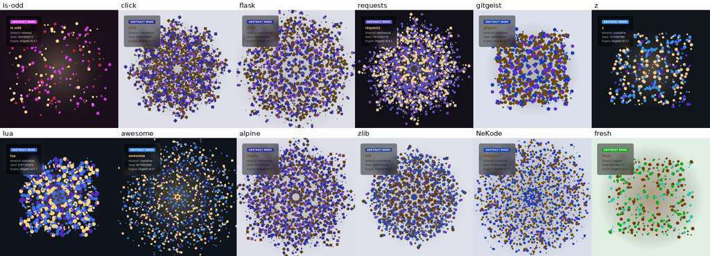
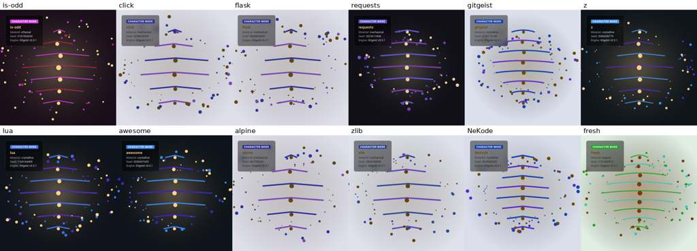

# Visual diversity: analysis

Path: `docs/features/visual-diversity/analysis.md`

Status: analysis, no product change. Measured on `main` at `03741e1` (gitgeist 0.5.1) on 2026-10-21. Code references (`file:line`) point to `03741e1`; stage 1 (PR #3, gitgeist 0.6.0) has since changed some of them. Design: `design.md`. Plan: `plan.md`.

## Answer

Different repositories look alike because the pipeline throws away almost everything that makes a repository specific, then squeezes what is left through saturated scales into one or two effective dimensions, and the renderers draw the same centered composition for every input.

1. Inputs saturate. Most repository features pass through hard caps sized for toy repositories (180 days, 30 commits, 50 kB, 50 files, a 200-character README). Any real project hits the cap, so maturity, identity strength and size read as "maximum" for 9 to 11 of 12 measured repositories.
2. The 14 visual axes are one signal. They are weighted sums of the same few scores, which are themselves driven by booleans (`has_tests`, `has_ci`, `has_readme`). Across 12 repositories the first principal component explains 80% of axis variance; 16 axis pairs correlate at |r| > 0.9 and `symmetry` equals `visual_rhythm` (r = 1.00).
3. The renderers ignore structure. Live mode draws a uniform random particle square, rotated into identical copies (abstract), or the same diamond-shaped spine ladder (character). No directory layout, timeline, language mix or hotspot reaches the canvas. Three of seven geometry parameters are computed and never read.
4. The prompt is mostly constant text. 20 of 48 prompt lines are identical for all 12 repositories, `click` and `alpine` get identical prompts, and the prompt contains no concrete repository fact, so image models fall back to their house style.

## Pipeline map

| Stage | Code | What it produces |
|---|---|---|
| CLI | `src/gitgeist/cli.py:32-33`, `cli.py:142-168` | `analyze`, `render --representation {character,abstract} --mode {live,prompt-to-image}` |
| Ingest | `src/gitgeist/features/extractor.py:36-48` | file tree scan, `git log`, README and license |
| Tree scan | `src/gitgeist/ingest/repository.py:117-231` | counts, languages by extension, booleans for tests, docs, CI, TODO count |
| Git history | `src/gitgeist/ingest/git_history.py:78-145` | commit count, authors, first and last date, churn, per-file change counts |
| History features | `src/gitgeist/features/history.py:25-40` | age, lifetime velocity, top 10 hotspots |
| Scores (layer 2) | `src/gitgeist/sensors/scores.py:13-141` | 10 scores in [0, 1] |
| Nouls | `src/gitgeist/sensors/nouls.py:9-57` | 7 boolean flags |
| Choices | `src/gitgeist/sensors/choices.py:36-83` | temperament, visual tone, energy profile |
| Visual latent (layer 3) | `src/gitgeist/mapping/axes.py:18-174`, `mapping/materiality.py:13-73` | 14 axes, materiality distribution |
| Live state | `src/gitgeist/render/abstract_renderer.py:24-69`, `render/character_renderer.py:24-66`, `render/palette.py:33-108`, `render/dynamics.py:9-34` | seed, palette, 4 motion values, 7 geometry values |
| Live canvas | `src/gitgeist/render/html_template.py:113-311` | animated Canvas 2D page |
| Prompt | `src/gitgeist/render/prompt_composer.py:79-145` | prompt text |
| Image backend | `src/gitgeist/render/image_backend.py:100-160` (OpenRouter), `image_backend.py:182-200` (fake) | portrait bytes |

There is no semantic layer: the JEV integration is recorded as `unmet` in `docs/product/invariants.md:7-16`. Every visual decision comes from the deterministic rules above.

The "animation mode" is `--mode live`: the HTML page animates the canvas with `requestAnimationFrame` (`html_template.py:297-310`). The "image mode" is `--mode prompt-to-image`. Both exist for both representations, so there are four combinations.

## Method

- Corpus: 12 repositories chosen to differ as much as possible: `is-odd` (tiny npm package, dormant 8 years), `click`, `flask`, `requests` (large mature Python), `gitgeist` (this repo, `main`), `z` (single shell script), `lua` (C, 33 years of history, one main author, flat layout), `awesome` (Markdown list, 681 authors), `alpine` (JavaScript frontend monorepo), `zlib` (old C library), `NeKode` (TypeScript Electron app, one author, 4 months old), `fresh` (synthetic: 3 files, 1 commit).
- Run: the pipeline functions from `main` called directly (`extract_features`, `evaluate_emotional_state`, `map_emotional_to_latent`, both live generators, `compose_prompt` for both representations), with a fixed `source_commit` so the seed does not depend on HEAD. No paid image API was called.
- Live screenshots: headless Chrome, 520x520, after 1.5 s of virtual time. Under D v1, `tools/diversity_report.py` freezes the animation clock at 1.5 s, so a rerun gives the same screenshot.
- Image distance: each screenshot is blurred (Gaussian, radius 12 at 256 px) and reduced to 8x8 for layout, plus a 12-bin hue histogram of saturated pixels. `D = 0.5 * layout_L1 / 0.25 + 0.5 * hue_histogram_distance`. Raw pixel distance was rejected as a metric because random particle noise scores as "different" while the portraits look the same. This is the pre-v1 definition; its exact parameters were not recorded.
- D v1 (`tools/diversity_report.py:28-35`): the same recipe with fixed parameters: each image resized to 256x256 and blurred (Gaussian, radius 12), layout as the mean absolute difference of the 8x8 RGB values, hue histogram of the unblurred pixels with HSV saturation > 0.25 and value > 0.15. `D = 0.5 * mean(|layout_a - layout_b|) / 0.25 + 0.5 * sum(|hue_a - hue_b|)`.
- Spread: participation ratio of the correlation-matrix eigenvalues (`1 / sum(p_i^2)`), the effective number of independent dimensions.

The original scripts and outputs were not kept, so the pre-v1 `D` numbers below cannot be reproduced. Stage 1 added the repeatable harness `tools/diversity_report.py`, which defines D v1; the D v1 baselines are listed after the pre-v1 table.

## Measurements

### Extracted features

| repo | files | size kB | commits | authors | age days | velocity/week | tests | CI |
|---|---|---|---|---|---|---|---|---|
| is-odd | 12 | 12 | 28 | 6 | 1192 | 0.16 | no | no |
| click | 178 | 1647 | 3379 | 470 | 4546 | 5.2 | yes | yes |
| flask | 236 | 1743 | 5562 | 858 | 6028 | 6.46 | yes | yes |
| requests | 128 | 4347 | 6495 | 790 | 5699 | 7.98 | yes | yes |
| gitgeist | 88 | 445 | 30 | 1 | 4 | 52.5 | yes | no |
| z | 5 | 19 | 217 | 27 | 5286 | 0.29 | no | no |
| lua | 111 | 1777 | 5868 | 6 | 12133 | 3.39 | no | no |
| awesome | 23 | 305 | 1209 | 681 | 4435 | 1.91 | no | yes |
| alpine | 310 | 5657 | 2415 | 336 | 2507 | 6.74 | yes | yes |
| zlib | 271 | 3542 | 1126 | 93 | 5920 | 1.33 | yes | yes |
| NeKode | 441 | 9654 | 128 | 1 | 19 | 47.16 | yes | yes |
| fresh | 3 | 0 | 1 | 1 | 0 | 1.0 | no | no |

The raw features do differ a lot (5 to 441 files, 1 to 6495 commits, 0 to 12133 days). The loss happens after extraction.

### Saturated inputs

| Rule | Code | Repos at the cap |
|---|---|---|
| maturity: age capped at 180 days | `sensors/scores.py:31` | 9/12 |
| maturity: commits capped at 30 | `sensors/scores.py:32` | 10/12 |
| novelty: floor of 0.25 once age >= 90 days and commits >= 10 | `sensors/scores.py:63-64` | 9/12 |
| identity: README capped at 200 characters | `sensors/scores.py:111` | 11/12 |
| identity: commits capped at 2 | `sensors/scores.py:114` | 11/12 |
| visual tone: size capped at 50 kB | `sensors/choices.py:54` | 9/12 |
| visual tone: files capped at 50 | `sensors/choices.py:55` | 8/12 |
| tension: authors capped at 5 | `sensors/scores.py:88` | 9/12 |
| volatility: velocity capped at 5/week | `sensors/scores.py:43` | 6/12 |

Downstream effects:

- `feels_overloaded` is true for 12/12 repositories, because `tension > 0.6` (`sensors/nouls.py:21-26`) holds for nearly everything once authors and velocity saturate.
- `identity_strength >= 0.9` for 11/12; `contrast` is "high" for 11/12; `luminosity` is "medium" for 12/12.
- `tension_curvature > 0.5` for 11/12, which overrides the accent hue to amber (`render/palette.py:60-61`). Every accent in the measured set is amber or brown.
- Materiality is `mechanical` or `crystalline` for 10/12, whose base hues are 0.55 and 0.60 (`render/palette.py:39-42`). Primary colors are blue to violet for 10/12.
- Temperament is `proud` for 9/12.

### Collapsed dimensions

| Layer | Participation ratio | First component | Pairs with |r| > 0.8 |
|---|---|---|---|
| 10 scores | 2.90 of 10 | 54% | 6 |
| 14 visual axes | 2.19 of 14 | 65% | 26 |

(Correlation-matrix PCA. Covariance PCA gives 1.51 effective dimensions for the axes, first component 80.5%.)

Strongest axis correlations: `symmetry`/`visual_rhythm` 1.00, `biological_vs_mechanical`/`ornamental_load` -0.99, `ornamental_load`/`opacity` -0.97, `sharpness`/`layering` 0.97, `symmetry`/`fragmentation` -0.96. The reason is visible in `mapping/axes.py:38-112`: `symmetry`, `visual_rhythm`, `sharpness`, `bio_vs_mech`, `opacity` and `layering` all add `discipline`, `coherence` and `maturity` and subtract `chaos`, while `discipline`, `maturity` and `chaos` are mostly sums of the same booleans (`sensors/scores.py:33-35`, `68-80`, `93-107`). In practice one hidden variable, "has tests, CI and a README", sets most of the portrait.

Features that are extracted but never reach any visual decision: `max_directory_depth`, `avg_file_size_bytes`, `first_commit_date`, `last_commit_date`, `readme_snippet`, which languages are present (only the top share and the count are used, `sensors/scores.py:21-22`, `126`), and hotspot paths (only the top count is used, `sensors/scores.py:52-53`). Signals that are not extracted at all: time since the last commit, activity over time, author concentration, directory layout, test-to-code ratio.

### Live mode

| Parameter | Spread across 12 repos | Used by the canvas |
|---|---|---|
| abstract `symmetry_order` | 8 for 7/12, 6 or 4 for 3, 1 or 2 for 2 | yes: draws the whole particle set `symmetry_order` times, rotated (`html_template.py:184-213`) |
| character `symmetry_order` | 2 for 10/12 | yes: asymmetry factor `asym` (`html_template.py:223`) |
| `density` | sd 0.066 | particle count (`html_template.py:148`) |
| `sharpness` | sd 0.218 | only as a threshold > 0.6 (`html_template.py:202`) |
| `organic_ratio` | sd 0.300 | character only, threshold > 0.5 (`html_template.py:261`); abstract ignores it |
| `layer_count` | 3 to 6 | character spine segments only (`html_template.py:221`); abstract ignores it |
| `curvature` | sd 0.094 | never read |
| `turbulence` | sd 0.071 | drift amplitude |
| `breathing_amplitude` | sd 0.030 | pulse scale |

What the canvas draws for every repository:

- Abstract: particles at uniform random positions in a 600 px square (`html_template.py:151-161`), a radial aura at the center (`html_template.py:174-182`), the particle set copied around the center `symmetry_order` times. With order 8 the result is a kaleidoscope. This is the "too symmetric" effect, and it is strongest for mature repositories because order grows with discipline and coherence (`abstract_renderer.py:35-44`).
- Character: a vertical spine of `layer_count + 3` ribs with a fixed diamond width profile `(1 - |y| * 1.4) * 160` (`html_template.py:241-248`), a center aura and an orbit of particles. The silhouette is the same for every repository; only the rib count, colors and line style change.
- The HUD shows material, seed and engine version (`html_template.py:97-103`), none of which tells the viewer anything about the repository.
- The seed hashes the profile and `source_commit` (`abstract_renderer.py:11-21`, `character_renderer.py:11-21`), so every new commit reshuffles the particles. The product asks the opposite: stable identity across snapshots (`docs/product/emotional-repository-portrait-system.md:841-857`).

Image distance `D`, pre-v1 (higher is more different). These are the original numbers; they are not reproducible, because the measurement parameters were not recorded:

| Render | Nearest-neighbour median | Closest pair |
|---|---|---|
| live abstract | 0.255 | 0.103 (`flask`, `alpine`) |
| live character | 0.164 | 0.043 (`gitgeist`, `NeKode`) |

Your two repositories (`gitgeist`, `NeKode`) are the closest pair in character mode.

Image distance `D` v1 (`tools/diversity_report.py`), nearest-neighbour median:

| Run | Abstract | Character | Closest pair (abstract; character) |
|---|---|---|---|
| `03741e1`, 12-repository analysis corpus | 0.192 | 0.083 | 0.123 (`gitgeist`, `NeKode`); 0.055 (`gitgeist`, `NeKode`) |
| v2 mockup (`design.md` "Mockup", abstract only) | 0.743 | - | 0.460 (`click`, `flask`); - |
| `main` before stage 1, box corpus | 0.228 | 0.083 | 0.108 (`flask`, `alpine`); 0.055 (`gitgeist`, `NeKode`) |
| `main` after stage 1 (0.6.0), box corpus | 0.186 | 0.091 | 0.082 (`flask`, `alpine`); 0.042 (`gitgeist`, `NeKode`) |
| `main` after stage 1 (0.6.0), 12 repositories under `F:\projects` | 0.234 | 0.242 | not recorded |

The box corpus is the same 12 repositories as checked out on the stage 1 build machine; `F:\projects` is a different set of repositories. Compare values only within one corpus. Stage 1 changes the seed and no visual mapping, so it moves `D` only a little; two runs on the same corpus gave identical values.

### Prompt-to-image mode

- 48 lines per prompt; 20 are identical for all 12 repositories (instructions, mode text, constraints, and the `luminosity: medium` line).
- `click` and `alpine` produce identical prompts (0 differing lines without the name line); `click`/`flask` and `flask`/`alpine` differ in 2 lines. On average two repositories differ in 14.6 of 48 lines.
- Values are cut into three bins at 0.33 and 0.66 (`render/prompt_composer.py:56-61`), so most differences inside a bin disappear, and the many saturated values all print as "high".
- No concrete fact reaches the model: no language, size, age, layout, hotspot or activity pattern. The only repository-specific word is the name (`prompt_composer.py:108-109`), which invites literal puns ("flask", "requests") rather than a portrait of the code.
- The prompt lists 24 abstract qualifiers with equal weight. Image models cannot honor 24 competing adjectives, so they keep a few and default to their house style. Your 13 model runs for `gitgeist` in the local, git-ignored `gitgeist-output/gitgeist/` directory (2026-09-19, not in the repository) all used one prompt, so they show model variety, not repository variety.
- The OpenRouter request sends no seed (`render/image_backend.py:125-126`), and the fake backend returns 16x16 hash noise (`image_backend.py:182-200`), which cannot show diversity offline.

## Other defects found

- Velocity is computed per week (`features/history.py:31-32`) but `summary.md` labels it "commits/day" (`explain/explainer.py:211`, `276`, `324`).
- Velocity is a lifetime average, so a repository with a rewritten or short history looks frantic: `gitgeist` 52.5 commits/week from 30 commits over 4 days on `main`.
- Tests in a `testes/` directory (Lua) are not detected; the set is fixed at `repository.py:150`.
- One `requests` commit has the timezone `+518:00`, which `datetime.fromisoformat` rejects; `git_history.py:27-32` drops such dates silently. Using `%at` (Unix time) avoids this.
- Light versus dark theme flips at `luminosity = 0.5` (`render/palette.py:71`), and 12/12 measured luminosity values lie between 0.40 and 0.65. Background color is close to a coin flip, which is the largest single visual difference between portraits today and carries almost no meaning.

## Conclusion

The fix is not tuning weights. The 14-scalar latent cannot make portraits distinct because shape needs structured data (layout, timeline, language mix, hotspots), and the scalar part needs normalization that spreads real repositories instead of capping them. Both live renderers need a composition that comes from that structure instead of a fixed template. `design.md` proposes this.
