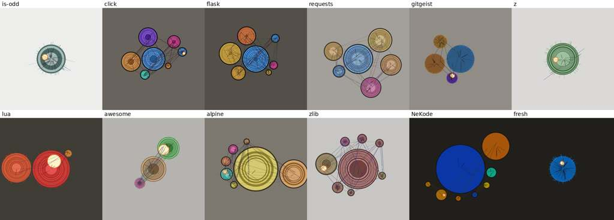

# Visual diversity: design proposal

Path: `docs/features/visual-diversity/design.md`

Status: design direction accepted; stage 0 decisions recorded on 2026-10-22 (see "Decisions"). Each stage still needs its spec before code. It has two interchangeable strategies: counters (measured features) and evaluation (an LLM scores a rubric); both produce the same `VisualSpec`. Evidence: `analysis.md`. Steps: `plan.md`.

## Goals

1. Different repositories look clearly different, in both representations (`abstract`, `character`) and both generation modes (`live`, `prompt-to-image`).
2. The main conclusions about a repository are readable at a glance, without a legend: size, age, whether it is alive, team shape, where change concentrates, care, sprawl.
3. Controlled unpredictability: a stable look per repository (identity seed), an optional user seed for a new variation, and switchable styles, all set by config and CLI flags.
4. Diversity is measured and guarded by tests.
5. Two switchable strategies feed the same portrait format: `counters` (deterministic, default) and `evaluation` (an LLM judges the repository against a rubric).

## Non-goals

- JEV integration. It stays `unmet` (`docs/product/invariants.md:7-16`); the evaluation strategy is a separate, optional LLM path (see "Relation to the product contracts").
- Literal programmer symbols or mascots. The prompt negative constraints stay.
- Multi-commit timelines and comparison views (product section 16). The identity seed makes them possible later.

## Decisions

Stage 0 decisions, made by you on 2026-10-22:

1. Channel rule accepted: one trait per abstract visual channel, including cracks for TODO and debt density. Recorded in [ADR 0001](../../decisions/0001-trait-per-abstract-channel.md). The product document's ban on "arbitrary assignment of one trait to one prop" (`docs/product/emotional-repository-portrait-system.md:418-421`) and its anti-examples (`:84-92`) still apply to props, symbols and character items.
2. First styles: `orbits` (abstract) and `creature` (character).
3. Default `--scale`: `absolute`.
4. Evaluation strategy enabled as an opt-in (`--strategy evaluation`); `counters` stays the default. Recorded in [ADR 0002](../../decisions/0002-optional-llm-evaluation-strategy.md).
5. First evaluator backend: the Antigravity CLI `agy` (Google Gemini models), adapter id `agy`. You call this path "gemini-cli"; the `gemini` binary is not used.

The channel rule in short: each trait owns one perceptual channel (footprint, rings, saturation, strands, focal knot, edge quality, topology, texture, cracks). Channels are abstract visual properties, never objects or symbols. Styles decide what the channels are drawn as, so the form still varies. `debt` drawn as cracks is close to the anti-example "many TODO -> scars"; it is allowed because cracks are a mark density every style draws its own way, not a fixed prop.

## Architecture

The layer order from the product document stays: features, interpretation, visual latent, renderer. Three things change inside it.

```text
repo
  -> features v2 (scalars + structure: layout, timeline, languages, hotspots, authors)
  -> strategy:
       counters:   normalization (log + reference percentiles) -> 9 traits
       evaluation: input bundle -> LLM evaluator -> rubric scores -> 9 traits
  -> traits (9 scalars) + structure (always factual) + existing emotional state (kept for explain)
  -> VisualSpec (renderer-neutral scene: masses, rings, palette, marks, motion, style, seed)
  -> live abstract | live character | prompt abstract | prompt character
```

- Structure, not only scalars. The current latent is 14 scalars that collapse to about 2 dimensions (`analysis.md`, "Collapsed dimensions"). Layout, timeline and language mix are lists, and they carry most of what makes a repository recognizable. They travel to the renderer as structure.
- One scene description for all four outputs. `VisualSpec` is computed once; the live renderers draw it and the prompt composer describes it. This is what makes live and prompt agree (product test 6, `:1318-1320`).
- Seeds only touch free choices. Traits and structure come from data. The seed picks the style (in `auto`), layout angle, hue offsets inside a family, noise phases and strand paths. A new seed gives a new picture with the same readings.

## Features v2

All come from the existing tree scan and two `git log` calls. Today's extraction takes at most 1.7 s on the corpus (`lua`, 5868 commits); the prototype of the extra features took 6.5 s for all 12 repositories together.

| Feature | Source | Notes |
|---|---|---|
| `days_since_last_commit` | `git log --format=%at` | relative to extraction time; use `%at` to avoid broken ISO zones |
| `timeline` | commits per month, first to last commit | stored as counts; renderers resample |
| `active_months_ratio` | months with at least one commit / months in span | separates steady from bursty |
| `author_count`, `top_author_share`, `top3_author_share` | `git log --format=%ae` | team shape, bus factor |
| `masses` | top-level directories (max 8, rest merged as `other`): file share, churn share, dominant language, test-file share | root files form a mass named `.` |
| `max_directory_depth` | existing, now used | |
| `language_shares` | top 5 by file count | existing data, now used by name |
| `hotspot_concentration` | top-10 file change share minus `min(1, 10 / file_count)` | size-adjusted, see below |
| `hotspots` | top 3 paths with change share and owning mass | existing data, now used by path |
| `test_ratio` | test files / code files, capped at 1 | replaces the `has_tests` boolean as the driver; directory names matched by `test` substring |
| `doc_ratio` | Markdown, reStructuredText and text files / files with a known language | |
| `todo_density` | TODO and FIXME per 1000 files | |
| `code_bytes` | bytes in files with a code language | separates code size from assets |

The raw `hotspot_top10_share` correlated at -0.92 with directory breadth on the corpus, because small repositories trivially concentrate change. Subtracting the share a uniform spread would give dropped the strongest trait correlation to 0.86 (breadth vs care).

## Normalization

Every scalar becomes a value in [0, 1] in two steps.

1. Log transform for counts and sizes: `log10(x + 1)`. Ratios stay linear.
2. Scale mode, selected with `--scale`:

| Mode | Meaning | Use |
|---|---|---|
| `corpus` (default) | percentile against a reference quantile table shipped in the package | portraits comparable across users |
| `portfolio` | percentile against the repositories you scanned before, stored in `~/.config/gitgeist/portfolio.json` (features only, opt-in) | maximizes contrast inside your own set |
| `absolute` | fixed log anchors, then `smoothstep` | reproducible without any table |

Percentiles spread values evenly by construction, so no trait sits at a cap for most repositories. The reference table is built offline by a dev script from a fixed list of public repositories (target about 200, spread over languages, sizes and ages) and versioned with `engine_version`. Until it exists, `absolute` is the default.

Absolute anchors (value at 0 and at 1): code size 10 kB and 100 MB; age 7 days and 20 years; days since last commit 1 and 5 years (inverted); authors 1 and 1000; TODO density 0 and 200 per 1000 files.

## Traits

Each trait has distinct inputs, so they do not move together the way today's axes do.

| Trait | Inputs | Formula before scaling |
|---|---|---|
| `size` | `code_bytes` | `log10` |
| `age` | first to last commit, days | `log10` |
| `alive` | `days_since_last_commit`, `active_months_ratio` | `0.5 * (1 - log(days) / log(3650)) + 0.5 * active_months_ratio` |
| `crowd` | `author_count`, `top_author_share` | `0.5 * log(authors) / log(1000) + 0.5 * (1 - top_author_share)` |
| `focus` | size-adjusted `hotspot_concentration` | clipped to [0, 1] |
| `care` | `test_ratio`, CI, `doc_ratio` | `0.6 * test_ratio + 0.2 * ci + 0.2 * min(1, 3 * doc_ratio)` |
| `sprawl` | top-level directory count, `max_directory_depth` | `log10(dirs + 1) + 0.1 * depth` |
| `prose` | `doc_ratio` | linear |
| `debt` | `todo_density` | `log10` |

Prototype on the same 12 repositories (`analysis.md` corpus, percentile scaling):

| Layer | Participation ratio | First component | Pairs with |r| > 0.8 |
|---|---|---|---|
| current 14 axes | 2.19 | 65% | 26 |
| prototype 9 traits | 3.37 | 47% | 2 |

The scalar gain is real but moderate. Most of the visible gain comes from the structure channels (layout, rings, hues), which a correlation number does not capture; see the mockup below.

The emotional scores, nouls and choices stay for `summary.md` and the explain layer. Renderers stop reading them. Whether the 14 axes stay in `profile.json` is decided in the stage 3 spec.

## Visual grammar

One trait, one primary channel ([ADR 0001](../../decisions/0001-trait-per-abstract-channel.md)). Every style must draw every channel, so a reading learned in one style transfers to the others.

| Trait | Channel | Range | Reading |
|---|---|---|---|
| `size` | footprint: share of the frame the form covers; element count | 25% to 85% of frame diameter; 40 to 600 elements | small or large |
| `age` + `timeline` | growth rings or strata: one per year, thickness by that year's commits | 1 to 40 rings (older history merged) | young or old; bursty or steady; quiet years visible |
| `alive` | saturation and motion speed | saturation 0.10 to 0.85; motion 0.05 to 1.2 Hz | dormant (faded, still) or active (vivid, moving) |
| `crowd` | strands threading the form | 1 to 12 | solo or team |
| `focus` + `hotspots` | focal knot: bright mark on the mass that owns the top hotspot, off its center | radius 15% to 50% of the mass | change concentrated in one place, or spread |
| `care` | edge quality | crisp outline and aligned marks at 1; frayed, blurred edge (up to 6 px, jitter up to 25% of radius) at 0 | tended or loose |
| `sprawl` + `masses` | topology: one mass per top-level directory, size by file share, depth as nested sub-shapes | 1 to 8 masses | flat or branched; lopsided or balanced |
| `prose` | fine hatching texture inside masses | 0% to 60% of mass area | code-heavy or text-heavy |
| `debt` | cracks and erosion marks | 0 to 60 | clean or marked |
| `language_shares` | hue family per mass from its dominant language; area by share | fixed hue per language, seed offset of up to 25 degrees | what the repository is made of |

Symmetry is no longer a parameter. It appears only when the data is balanced (similar mass sizes, even timeline). The rotated-copy kaleidoscope (`html_template.py:184-213`) and the fixed spine profile (`html_template.py:248`) are removed.

Language hues make same-language repositories share a family (`click`, `flask`, `requests` are all Python). Layout, rings, knot and strands still separate them, and the seed shifts the hue inside the family. If that is not enough, `--palette seeded` drops the language rule for palette and keeps it in the caption.

### Composition and layout

Masses are placed by a seeded spiral packing: the largest mass near the center, the rest at increasing distance, starting angle from the seed. Unequal directory sizes produce asymmetric compositions on their own. With the same identity seed, a new commit moves masses only when directory shares change.

### Motion grammar (live)

The animation shows history instead of a generic pulse.

- One loop replays the timeline in 12 s: global pulse amplitude follows commits per period, so bursts, quiet years and revivals are visible as a rhythm. The loop ends on the last 90 days.
- Base speed and drift follow `alive`: a dormant repository barely moves.
- The focal knot flickers with its file's change frequency.
- Strands move independently; more authors means more independent motion.
- No mirrored or rotated copies.

### Styles

Styles change how channels are drawn, never which trait drives which channel. `--style auto` lets the seed pick from the styles that fit the data; `--style <name>` fixes one. The first styles to build are `orbits` and `creature` (stage 0 decision); the others follow in plan stage 8.

| Representation | Style | Draws masses as | Fit hint for `auto` |
|---|---|---|---|
| abstract | `orbits` | bodies with growth rings, strands as orbits | default |
| abstract | `strata` | geological layers (timeline) with masses as inclusions | long history |
| abstract | `topography` | contour map, height by churn | high churn |
| abstract | `weave` | threads per author over time | large team |
| character | `creature` | body plan: torso is the largest mass, limbs are other masses, limb segments by depth | default |
| character | `tree` | trunk and branches from the directory tree, rings in the trunk | deep tree |
| character | `colony` | many small bodies, one per mass | flat, many top-level directories |
| character | `totem` | stacked segments, one per mass | few large masses |

`--variety {low,medium,high}` sets how much the seed may change: hue offset 10, 25 or 45 degrees; layout jitter; `auto` picks from 1, 3 or all fitting styles.

## Seeds

- Identity seed: SHA-256 of the root commit hash (all roots, sorted). Without Git: the directory name. Stable across commits, branches and clones. Written to `identity-seed.json`, which the product already lists as an optional artifact (`:1166-1170`).
- User seed: `--seed <int>` or `--seed random`. `random` prints the chosen value and records it, so any picture can be reproduced.
- Effective seed: hash of identity seed, user seed and style. Stage 1 (0.6.0) already replaced the old seed (hash of the profile and HEAD) with one derived from the identity seed and the mode (`render/abstract_renderer.py:10-17`, `render/character_renderer.py`), so commits no longer reshuffle the picture; the user seed and style are added later.

## Reading at a glance

- Live HUD: replace material, seed and engine (`html_template.py:97-103`) with the three most extreme traits as plain phrases with their numbers, for example "33 years old", "one main author (98%)", "last commit 4 days ago". Hover on a mass shows its directory, files and top hotspot. Toggle with `--caption on|off` (default on).
- Prompt-to-image: the model is never asked for text. With `--caption on`, gitgeist adds the same three phrases as a strip under the image with Pillow (already an optional dependency, `pyproject.toml` extra `image`).
- `summary.md` gets a "Reading this portrait" section mapping each visible channel to its trait value.

## Prompt-to-image

The prompt describes the `VisualSpec`, not 24 qualifiers.

1. One subject sentence from representation and style, for example "An abstract composition of five separate bodies with concentric growth rings, seen from above."
2. Five to seven concrete directives from the most extreme traits only, each stated as something visible: count, relative size, position, color, edge. Traits near the middle are left out, because "medium" adds no information.
3. Palette as hex colors from the same palette code the live renderer uses.
4. Medium from the style pack (for example ink, cut paper, carved stone, macro photography), chosen by seed.
5. Existing negative constraints.
6. Repository name left out by default, to avoid literal puns; `--prompt-name` adds it back.

Example for `lua` (33 years, one main author, last commit 4 days ago, three top-level directories; colors are illustrative):

```text
An abstract composition of two large bodies and one small one, off-center to the left, on a dark ground.
- Each large body shows 33 thin concentric growth rings, thickest in the middle rings.
- One bright, small knot sits off-center inside the larger body.
- A single thin strand links the bodies.
- Slightly frayed edges; no cracks.
- Vivid, saturated color: #d8432e, #b8321f, #f2c94c on #2b2620.
Medium: carved and painted stone relief.
No text, no letters, no logos, no code, no screens, no mascots.
```

Pass the effective seed to the backend when the API accepts one (to verify for OpenRouter images). The fake backend draws a small raster of the `VisualSpec` instead of hash noise, so offline tests show the composition.

That concrete directives make image models follow repository structure is an assumption. Plan stage 6 checks it with a small paid A/B run, after your approval.

## Strategy 2: rubric evaluation

The counter strategy (everything above) measures a repository. The evaluation strategy judges it: a language model scores the repository against a fixed rubric, and those scores drive the portrait. Both strategies produce the same `VisualSpec`, so every renderer, style, seed and flag works with either. Selected with `--strategy counters|evaluation` (config key `strategy`).

### Why a second strategy

Counters see size, history and file names. They cannot see whether the README explains the purpose, whether the tests test anything, or whether the code has a voice. A model reading a sample of the repository can. Different models, and different prompts, attend to different things and will judge the same repository differently. For a curiosity project that is a feature: the same repository seen through another model or another lens gives another, still grounded, portrait. Lenses are a switchable option (see "Lenses").

### Rubric

17 criteria, each scored 0 to 4. The shared anchors are: 0 absent or harmful, 1 weak, 2 typical for public repositories, 3 clearly good, 4 exemplary. Each criterion adds its own anchors for 0, 2 and 4 so the model has concrete reference points. `null` is allowed only when the bundle has no evidence for the criterion (for example code readability in a docs-only repository), and must carry a reason.

| Id | Criterion | 0 | 2 | 4 |
|---|---|---|---|---|
| `purpose` | Purpose clarity | cannot tell what it is for | purpose stated, scope vague | one-sentence purpose, audience and limits clear |
| `docs` | Documentation | none | README covers basic use | usage, concepts and reference, kept current |
| `onboarding` | Onboarding | no way to install or run | install steps exist, some guessing | one command or short documented path to a working setup |
| `readability` | Code readability | opaque names, huge functions | readable with effort | names and structure explain the code |
| `architecture` | Architecture and modularity | one tangle | some separation, leaky boundaries | clear modules with stable interfaces |
| `tests` | Test depth | no tests | tests for main paths | tests cover behavior and edge cases, readable as a spec |
| `automation` | Automation and tooling | none | some scripts or CI | CI, lint, format and release automated |
| `robustness` | Error handling and robustness | errors ignored or swallowed | common errors handled | failures explicit, inputs validated |
| `consistency` | Consistency of conventions | each file its own style | mostly consistent | one style everywhere, enforced |
| `maintenance` | Maintenance and liveliness | abandoned, open rot | occasional upkeep | steady, recent care |
| `change_discipline` | Change discipline | giant unexplained commits | mixed | small, well-described commits |
| `dependencies` | Dependency hygiene | many, unpinned or stale | reasonable | few, pinned, current |
| `security` | Security hygiene | secrets or unsafe defaults visible | nothing alarming | safe defaults, documented handling of secrets |
| `focus` | Scope focus | sprawling, unrelated parts | mostly one job | does one thing well |
| `ambition` | Ambition and novelty | trivial copy of known things | useful, familiar | unusual idea or hard problem done well |
| `voice` | Character and voice | no personality | some tone | a distinct, recognizable voice in docs and code |
| `collaboration` | Collaboration readiness | closed to others | contributors could manage | contribution guide, templates, welcoming review history |

Besides scores, the model must name its 3 strongest and 3 weakest criteria (distinct ids) and one `focal_path`: the file or directory that best explains its judgment.

### Evaluator input bundle

Built by gitgeist, deterministic for a given commit, saved as `evaluation-input.json` next to the other artifacts so you can see what the model saw.

| Part | Content | Budget |
|---|---|---|
| features | features v2 JSON (`design.md` "Features v2") | full |
| tree | relative paths of tracked files, depth-first, sorted | 2000 entries |
| readme | README text | 8000 characters |
| manifests | `pyproject.toml`, `package.json`, `Cargo.toml`, `go.mod` and similar | 4000 characters each |
| code samples | top 3 hotspots, largest file per mass, one entry point, one test file; each cut to 200 lines | 60000 characters total |
| git | counts and dates from features, last 30 commit subjects | 3000 characters |

Total budget is set by `--eval-budget` (characters, default 90000, about 25000 tokens). Only tracked files are read. Files matching `.env*`, key and certificate patterns, binaries and `.agents/` are never included. API and CLI backends send the bundle to their provider, so the evaluation strategy runs only when a backend is configured explicitly; there is no default backend.

### Evaluator contract

```text
Evaluator.evaluate(bundle: EvaluationBundle, rubric: Rubric, lens: Lens) -> RubricResult
```

Output JSON schema (`RubricResult`, Pydantic, frozen):

```json
{
  "schema_version": "1",
  "rubric_version": "1",
  "prompt_version": "1",
  "lens": "default",
  "backend": "openrouter",
  "model_id": "deepseek/<model>",
  "bundle_sha256": "...",
  "scores": {
    "purpose": {"score": 3, "evidence": "README line 1 states the goal and audience", "refs": ["README.md"]}
  },
  "strengths": ["tests", "docs", "purpose"],
  "weaknesses": ["onboarding", "dependencies", "collaboration"],
  "focal_path": "src/core.py",
  "summary": "max 300 characters"
}
```

Validation, all errors fatal:

- every rubric id present, no unknown ids;
- `score` is an integer 0 to 4, or `null` with a non-empty reason in `evidence`;
- `evidence` 1 to 240 characters; every path in `refs` and `focal_path` exists in the bundle tree;
- `strengths` and `weaknesses` are 3 distinct valid ids each, with no overlap;
- `rubric_version` and `prompt_version` match the ones sent.

On invalid output, gitgeist re-asks once with the validation errors listed, and records that retry in the result. A second invalid answer is an error.

Caching: key is SHA-256 of identity seed, `bundle_sha256`, rubric version, prompt version, lens, backend and model id. Results are stored in `~/.cache/gitgeist/evaluations/<key>.json`. A new commit changes the bundle and so the key; `--eval-refresh` ignores the cache. A cached result makes a run reproducible, because model output is not.

Timeouts: 180 s for CLI backends, 120 s for HTTP, configurable.

Failure behavior, per `AGENTS.md` (no silent fallback): a missing CLI binary, failed authentication, timeout, non-JSON output or a second validation failure stops the run with a non-zero exit and a message naming the backend and the cause. gitgeist never falls back to the counter strategy or to another backend on its own, and writes no portrait for a failed evaluation.

### Adapters

| Adapter | Call | Billing |
|---|---|---|
| `command` | any CLI that reads the prompt on stdin and prints JSON; command line from config | depends on the tool |
| `grok-cli` | `grok -p` (non-interactive) | your subscription |
| `agy` | Antigravity CLI (Google Gemini models; the path you call "gemini-cli"): `agy -p --print-timeout <seconds>`, with `--model`, `--output-format json` and `--json-schema` available per `agy --help` (checked 2026-10-22); first backend | your subscription |
| `openrouter` | chat completions with a JSON schema response format; model from config (current DeepSeek or a Flash model); key in `OPENROUTER_EVAL_API_KEY` | paid per token |
| `fake` | returns a fixed or seeded `RubricResult`; tests only | none |

Exact flags for each CLI are checked when the adapter is built (plan stage 11). Temperature 0 where the backend supports it.

Subscription backends cost no money per call but use your quota and send code to the provider; API backends cost money. Any run on your repositories needs your yes. Expected cost for one corpus run (12 repositories, about 25000 input tokens each) on a cheap API model is under 1 USD; check current prices before the run.

### Lenses

A lens is a prompt variant that changes what the model attends to. The rubric and output schema stay the same, so lenses are interchangeable. Selected with `--lens` (config key `evaluation.lens`), recorded in the result and shown in the caption.

| Lens | Attends to |
|---|---|
| `default` | balanced reading of all criteria |
| `newcomer` | first hour: README, onboarding, purpose |
| `maintainer` | tests, robustness, change discipline, dependencies |
| `craftsperson` | readability, architecture, consistency, voice |
| `archaeologist` | history, maintenance, how the project changed |
| `critic` | weakest points first, no benefit of the doubt |

### Flat scores, the one real risk

Disagreement between models is welcome. The risk is a dull result: a model gives most criteria 3 and every repository looks the same again.

Measures, on the corpus after each run:

- per-criterion standard deviation across repositories (0 to 4 scale);
- modal share: share of all scores equal to the single most common value;
- per-repository standard deviation across criteria;
- after mapping, the same trait participation ratio and image distance `D` as the counter strategy.

Targets: standard deviation at least 0.8 for 12 of 17 criteria; modal share at most 40%; per-repository standard deviation at least 0.7 for 10 of 12 repositories.

Mitigations, in order of cost:

1. Concrete anchors per criterion, with 2 defined as "typical", so 3 and 4 must be earned.
2. Forced choice: 3 strengths and 3 weaknesses per repository; the mapping adds +1 and -1 to those criteria before scaling.
3. Percentile scaling across the evaluated corpus (`--scale corpus` or `portfolio`), which spreads scores even when the raw range is narrow.
4. Lenses that ask the model to look from one angle.
5. Ranking mode (later): the model compares 4 repositories at a time per criterion, which forces differences.

### Mapping rubric scores to traits

Structure stays factual in both strategies: masses, timeline and rings count, language hues and hotspot positions come from features v2. What changes is the 9 trait values, so the same skeleton looks different depending on the judgment.

Each criterion score becomes `s / 4` (forced-choice adjustment applied, clipped to [0, 1]), then is scaled with the active `--scale` mode. A trait is the mean of its criteria, ignoring `null` scores; a trait whose criteria are all `null` is an error unless the rubric marks it optional for that repository type (docs-only), in which case the trait is set to the corpus median and the caption says so.

| Channel | Counter trait | Evaluation trait | Criteria |
|---|---|---|---|
| footprint | `size` | substance | `ambition`, `architecture` |
| rings (count stays factual) | `age` | history craft: ring regularity and contrast | `change_discipline`, `maintenance` |
| saturation and motion | `alive` | vitality | `maintenance`, `voice` |
| strands | `crowd` | openness | `collaboration`, `onboarding` |
| focal knot | `focus` | standout: knot size from the spread between strongest and weakest criteria; placed on `focal_path` | `strengths`, `weaknesses` |
| edge quality | `care` | rigor | `tests`, `automation`, `robustness`, `consistency`, `readability` |
| topology (masses stay factual) | `sprawl` | clarity: separation and alignment of masses | `architecture`, `focus` |
| hatching | `prose` | communication | `purpose`, `docs` |
| cracks | `debt` | risk (inverted) | `robustness`, `security`, `dependencies` |

The HUD and caption name the strategy, backend, model and lens, and use the evaluation's top strength, top weakness and `summary` as the three plain conclusions.

### Comparing the strategies

Run both strategies on the 12-repository corpus from `analysis.md`, same styles and seeds, one evaluation backend and the `default` lens.

- Trait-level: Spearman correlation per channel between counter and evaluation trait values across the 12 repositories.
- Image-level: for each repository, distance `D` between its two portraits; compare with the nearest-neighbour distance inside each strategy.
- Side-by-side contact sheet: one row per repository, columns counters and evaluation (and a second backend or lens if run).

Acceptance:

1. The evaluation strategy alone meets the diversity targets of the counter strategy (nearest-neighbour median `D` v1 at or above the stage 4 and 5 targets in `plan.md`) and the flat-score targets above.
2. For at least 8 of 12 repositories, the cross-strategy distance is at least the median nearest-neighbour distance inside the counter strategy: the two portraits of one repository differ as much as two different repositories do.
3. Mean absolute Spearman correlation across channels is at most 0.8; if every channel is above 0.9, the evaluation adds nothing and the strategy is reconsidered.
4. Your review of the side-by-side sheet.

The comparison run calls an LLM backend and needs your yes.

### Relation to the product contracts

`docs/product/invariants.md:7-16` records the JEV integration as `unmet`, and the current specs (`docs/features/feature-extraction/spec.md`, `docs/features/emotional-state-model/spec.md`) describe a deterministic-only interpretation. The product document does foresee a stronger LLM summarizing the repository and choosing important traits (`docs/product/emotional-repository-portrait-system.md:360-366`). The evaluation strategy is an optional LLM interpretation path; it is not JEV, and its existence must not be reported as meeting the `jev-real-integration` invariant (its `blocking_scope` forbids that). Stage 0 recorded this as [ADR 0002](../../decisions/0002-optional-llm-evaluation-strategy.md): the path is enabled as an opt-in, the counter strategy stays the default, and the invariant stays `unmet`.

## Configuration and CLI

New flags on `gitgeist render` (and on `analyze` where they affect `profile.json`):

| Flag | Values | Default |
|---|---|---|
| `--style` | `auto` or a style name for the representation | `auto` |
| `--seed` | integer or `random` | none (identity seed only) |
| `--variety` | `low`, `medium`, `high` | `medium` |
| `--scale` | `corpus`, `portfolio`, `absolute` | `absolute` (stage 0 decision) |
| `--palette` | `language`, `seeded` | `language` |
| `--caption` | `on`, `off` | `on` |
| `--prompt-name` | flag | off |
| `--strategy` | `counters`, `evaluation` | `counters` |
| `--evaluator` | `command`, `agy`, `grok-cli`, `openrouter`, `fake` | none; required with `--strategy evaluation` |
| `--lens` | `default`, `newcomer`, `maintainer`, `craftsperson`, `archaeologist`, `critic` | `default` |
| `--eval-budget` | characters | 90000 |
| `--eval-refresh` | flag | off |

Config keys: `strategy`, and an `[evaluation]` table with `backend`, `model`, `command`, `lens`, `budget`, `timeout_seconds`. API keys stay in `.env` (`OPENROUTER_EVAL_API_KEY`), never in the config file.

Optional config file, same keys, precedence: CLI, then `./gitgeist.toml`, then `~/.config/gitgeist/config.toml` (same directory as the existing user `.env`, `src/gitgeist/env.py:68-71`), then defaults. Unknown keys are an error, not ignored.

## Testing diversity

Metrics live on `VisualSpec`, not on pixels, so tests are fast and deterministic. Pixel metrics stay a dev tool, because random particle noise scores as "different" while portraits look the same (`analysis.md`, "Method").

- Spec distance: L1 over trait values + earth mover's distance over mass size vectors + hue histogram distance over the palette + 1 if the style differs; each part scaled to [0, 1] and averaged.
- Golden diversity test: about 8 synthetic fixture repositories built with `tests/fixtures/builder.py` (single script, dormant old, big team, single-author monorepo, docs-only, fresh one-commit, one-hotspot, deep tree). Assert the nearest-neighbour spec distance is at least a threshold set from the first passing run, and no trait is constant across the fixtures.
- Golden snapshots: the fixture `VisualSpec` JSON files are committed and change only with an explicit update flag.
- Channel isolation: changing one raw feature changes only its trait and that trait's channel fields.
- Monotonicity: each trait rises with its input.
- Determinism and seeds: same repository and seed give identical spec and HTML; another user seed keeps traits and structure identical and changes free fields; a fixture commit that touches one file keeps the identity seed and moves no mass by more than a small threshold.
- Reference corpus check (offline dev script, not CI): trait participation ratio and maximum |r|, reported with each engine version. Target: no trait pair above |r| 0.8.
- Evaluation strategy: contract tests with the `fake` evaluator (schema validation, every invalid case, the single re-ask, cache key and hit, timeout and missing-binary errors, no fallback); bundle builder tests (budget limits, excluded files, determinism); mapping tests (criteria to traits, `null` handling, forced-choice adjustment). No test calls a real backend.
- Image check (dev script `tools/diversity_report.py`): headless Chrome contact sheet with a frozen 1.5 s animation clock and distance `D` v1. Baseline nearest-neighbour median at `03741e1`: 0.192 (abstract), 0.083 (character). Mockup: 0.743. Targets (decided 2026-10-22): at least 0.40 (abstract, stage 4) and 0.25 (character, stage 5) on the 12-repository corpus. The pre-v1 numbers in `analysis.md` (0.255, 0.164, mockup 0.462, target 0.40) are not comparable.

## Mockup

A static Pillow sketch of the abstract `orbits` style using the prototype traits and features (not product code; masses cycle through the repository's languages instead of using each directory's own language):



What it shows: `is-odd` and `z` are pale and faded (dormant for years), `lua` has two large masses with many rings and one strand (old, one author), `NeKode` and `gitgeist` are vivid with few rings (young, active), `awesome` is light with frayed edges (text-heavy, no tests), `zlib` and `requests` are many ringed masses (old, broad). On the image distance `D` v1, the nearest-neighbour median goes from 0.192 (abstract) and 0.083 (character) at `03741e1` to 0.743, and the closest pair from 0.123 and 0.055 to 0.460. The pre-v1 numbers were 0.255 and 0.164 to 0.462, and 0.103 and 0.043 to 0.300.

## Risks

- Readability competes with variety. The language-hue rule and fixed channels make portraits learnable but can make same-stack repositories look related. `--palette seeded` and the style pool are the release valve.
- A corpus table must be kept current. Without it, `absolute` scaling is less even; the 12-repository prototype used percentiles inside the corpus.
- Prompt adherence of image models is unverified (stage 6).
- Evaluation strategy: the only real risk is flat, uninteresting scores (see "Flat scores, the one real risk"). Differences between models and lenses are intended. Model output is not reproducible without the cache.
- `profile.json` changes shape; `engine_version` must change and the README determinism claim for `analyze` must be rechecked.
